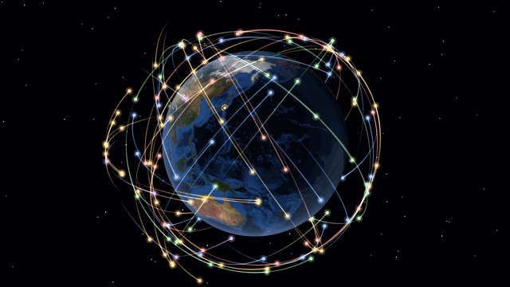

# GNSS Orbit Viewer

[English](README.md)

GPS・GLONASS・Galileo・BeiDou・QZSS の衛星を、3D 地球とともにリアルタイム表示するライブ壁紙／Web アプリです。



- **実際の軌道**: [CelesTrak](https://celestrak.org/) の最新の軌道要素を取得し、Web Worker 上の SGP4 で計算。各衛星は「今いる位置」に表示される
- **実際の空**: 地球は恒星時に従って自転し、昼夜の境界と夜景は実際の太陽位置に追従する
- **2 つのテーマ**: NASA の画像と控えめな軌跡の *Realistic*、暗い地図・経緯線・衛星群ごとの鮮やかな色の *Technical*
- **見やすさ**: 消えていく過去の軌跡／軌道全体の表示、衛星群ごとの表示切替、重なりを避ける衛星ラベル
- **高度の圧縮**: GNSS 衛星は地球半径の 3〜6 倍の距離にあるため、既定では地表からの高さだけを 10% に縮めて表示。100% で実寸
- **現在地**: おおよその現在地にマーカーを表示。タイムゾーンから推定（IP・GPS は使わない）するか、緯度経度を手動で指定
- **あなたの空**: 現在地の地平線より上にいる衛星を強調し、現在地からの見通し線と衛星群ごとの機数（例: 「あなたの空の衛星: 57 機」）を表示
- **壁紙向けの配慮**: 非表示中・Lively の一時停止中は描画を止める。フレームレート上限、軌道データのローカルキャッシュ
- **10 言語対応**: 英語・日本語・简体中文・繁體中文・한국어・Русский・Español・Français・Deutsch・Português (Brasil)（既定はシステムの言語に追従）

## Lively Wallpaper で使う

1. [Releases](https://github.com/MenEnger/gnss-wallpaper/releases) から `gnss-orbit-viewer-lively-<version>.zip` をダウンロード
2. zip を Lively のウィンドウにドラッグ＆ドロップ
3. 壁紙を右クリック →「カスタマイズ」でテーマ・ラベル・軌道線・高度倍率・衛星群・現在地・カメラ・時間倍率・FPS 上限を変更

補足:
- 軌道データ（最短 2 時間ごと）と地表画像の取得にネット接続が必要。2 回目以降はネットに繋がらなくてもキャッシュした軌道データで動く
- Lively はマウスのボタン状態を正しく転送しないため、Lively 上ではドラッグによる視点操作は無効（自動周回のみ）

## 開発

```bash
npm install
npm run dev            # http://localhost:5173
npm run build          # dist/ に静的ファイルを出力
npm run build:lively   # release/ に Lively 用 zip を出力
```

ドラッグで回転、ホイールでズーム。`H` キーで設定パネルの表示／非表示。

### 構成

| ディレクトリ | 役割 |
| --- | --- |
| `src/data/` | CelesTrak からの OMM(JSON) 取得・キャッシュ・鮮度判定、衛星群の分類、現在地の推定 |
| `src/orbit/` | SGP4 計算（Web Worker）、時刻格子での標本管理と補間、シミュレーション時計、太陽方向・GMST |
| `src/render/` | three.js による描画（地球・マーカー・軌跡・ラベル・カメラ）。計算は持たない |
| `src/config/` | 設定（`settings.ts`）とビジュアルテーマ（`themes.ts`）。衛星データとは独立 |
| `src/ui/` | 設定オーバーレイ（lil-gui）と状態表示 |
| `src/host/` | 壁紙ホスト向けの公開 API、Lively 連携 |
| `src/i18n.ts`, `src/locales/` | 表示言語の切り替えと各言語の表示文（英語 `en.ts` がキーの基準） |
| `scripts/` | Lively 用 zip の作成、タイムゾーン座標表の生成 |

- 描画は慣性系（TEME ≒ ECI）。軌道面は固定され、地球が GMST に従って自転する
- 衛星の描画半径 = `Re + (r − Re) × 高度倍率`（地球の大きさは不変、点と軌道線に同じ倍率）。内部の位置（km）は倍率を掛けずに保持
- 軌道データは `GROUP=gnss` を取得し、`OBJECT_NAME` で衛星群を分類（SBAS・NavIC は除外）。2 時間以内は再取得しない
- 現在地の自動推定は `Intl.DateTimeFormat().resolvedOptions().timeZone` を `src/data/timezones.ts`（IANA tz の zone.tab から生成）で座標に変換する

### Lively 連携

- カスタマイズ画面の項目は `src/host/livelyProperties.ts` に英日両方で定義し、`LivelyProperties.json` と `LivelyProperties.loc.json`（Lively v2.2 以降で日本語表示）を生成する
- `LivelyInfo.json` の `"Arguments": "--pause-event true"` により、Lively の一時停止中は描画と軌道計算を止める
- Lively はファイルを自分のライブラリにコピーするため、ビルドし直したら取り込み直しが必要。開発中は `npm run dev` を動かしたまま URL `http://localhost:5173` を壁紙として追加すると変更がそのまま反映される
- Lively はマウス移動を常に `MK_XBUTTON1` 相当の値付きで転送し、押下・解放はデスクトップが前面のときしか転送しない。ドラッグ状態の取り残しを防ぐため、左ボタンが押されていない移動でドラッグを終了させている（`src/host/inputGuard.ts`）

### 外部からの制御（壁紙ホスト向け）

URL クエリ:

```
?theme=technical&labels=id&orbit=full&trail=90&alt=1&speed=60&autocam=0&camspeed=2&camdist=14&ui=0&fps=30&gnss=gps,galileo&lang=ja&location=manual&lat=35.68&lon=139.77
```

JavaScript / postMessage:

```js
window.gnssViewer.setSettings({ theme: 'technical', altitudeScale: 1 });
window.gnssViewer.setPaused(true);           // ホスト側で不可視になったとき描画停止
window.gnssViewer.onStatus((s) => console.log(s.state, s.code, s.params));

window.postMessage({ type: 'gnss-viewer:settings', settings: { labelMode: 'id' } });
window.postMessage({ type: 'gnss-viewer:paused', paused: true });
```

## クレジット

- 軌道データ: [CelesTrak](https://celestrak.org/) GP データ（OMM/JSON）。[satellite.js](https://github.com/shashwatak/satellite-js) の SGP4 で計算
- 地表画像: **NASA** Blue Marble / Black Marble（NASA Earth Observatory）。[three-globe](https://github.com/vasturiano/three-globe) のサンプル画像を実行時に読み込んでおり、本プロジェクトには同梱していない。NASA による推奨を意味するものではない
- タイムゾーンの位置: [IANA tz データベース](https://github.com/eggert/tz)（パブリックドメイン）
- 描画: [three.js](https://threejs.org/)、設定パネル: [lil-gui](https://lil-gui.georgealways.com/)

## ライセンス

[MIT](LICENSE)。地表画像と軌道データはそれぞれの提供元のもので（クレジット参照）、このライセンスの対象外です。
